# ⊞ IDM SEMO (BELGESELSEMO) — Windows

<p align="center">🌐 <strong>Türkçe</strong> · <a href="#english">English</a> · <a href="README.md">🐧 IDM LINUX</a> · <a href="https://rawgit.loltek.net/https://raw.githubusercontent.com/vesvese55x/IDM-LINUX/refs/heads/main/promo/promo.html">🌍 Ortak tanıtım / Showcase</a></p>

<table align="center"><tr><td align="center"><a href="README.md"><strong>🐧 IDM LINUX · Linux</strong></a></td><td align="center"><strong>🔵 ⊞ IDM SEMO · Windows</strong></td></tr></table>
<p align="center"><sub>GitHub uyumlu bağlantılı ürün sekmeleri / Linked product tabs: Linux · Windows</sub></p>


<p align="center">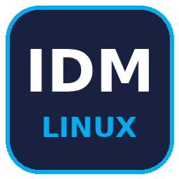 ×  × </p>

<p align="justify"><strong>IDM SEMO</strong>, Windows için yerel WinForms tabanlı bir IDM entegrasyonu ve kontrol merkezidir. Tarayıcı köprüleri, video araçları, indirme hedefleri, tanı günlükleri ve kullanıcı tarafından başlatılan torrent/eD2K kuyruğu tek bir pencerede yönetilir. Linux için Wine tabanlı sürümü arıyorsanız <a href="README.md"><strong>IDM LINUX sekmesine dönün</strong></a>; bu sayfa Windows ürününü anlatır.</p>

<p align="center"><a href="https://github.com/vesvese55x/IDM-LINUX/releases/download/v1.0.0/IDM-SEMO-1.0.0-x86_64.exe"><strong>⬇ IDM-SEMO-1.0.0-x86_64.exe</strong></a> · <a href="https://raw.githubusercontent.com/vesvese55x/IDM-LINUX/refs/heads/main/belgeselsemo-idm-windows-installer.bat">BAT alternatifi</a> · <a href="#windows-cmd-kurulum">CMD kurulumu</a> · <a href="https://github.com/vesvese55x/IDM-LINUX/releases/tag/v1.0.0">Release notları</a></p>

## Neden IDM SEMO?

<p align="justify">🪟 <strong>Yerel Windows arayüzü:</strong> Wine gerektirmeyen kontrol paneli; kurulum, genel bakış, tarayıcılar, ayarlar, sistem doktoru, proje galerisi, destek, dil seçimi, hakkında ve torrent/eD2K sayfaları.</p>
<p align="justify">📂 <strong>Düzenli hedefler:</strong> IDM kategorileri <code>Downloads\IDM-SEMO</code> altında düzenlenir. Yerel IDM kategori kayıtları ile panel hedefleri eşleştirilir.</p>
<p align="justify">⏯ <strong>Kontrol sizde:</strong> yeni torrent/eD2K girişleri durmuş satırlar olarak eklenir; aktarımı siz başlatırsınız. Başlat/Duraklat tek kontrol üzerinden yönetilir. Arayüzü tekrar açma/öne getirme ve mevcut kuyruğu koruma davranışı sürer.</p>
<p align="justify">🌐 <strong>Tarayıcı ve video araçları:</strong> varsayılan tarayıcı algılama, Chromium/Firefox eklenti bağlantıları, eklenti klasörü ve Native Messaging durumları aynı sayfada. Tarayıcının izin/mağaza adımları gerektiğinde kullanıcı tarafından tamamlanır.</p>
<p align="justify">🩺 <strong>Teşhis ve kişiselleştirme:</strong> canlı günlükler, sistem doktoru, 20 arayüz dili, BELGESELSEMO proje galerisi ve destek bağlantıları.</p>

## Üç kurulum yolu

| Yöntem | Kullanım | Komut penceresi |
|---|---|---|
| [**EXE — önerilen**](https://github.com/vesvese55x/IDM-LINUX/releases/download/v1.0.0/IDM-SEMO-1.0.0-x86_64.exe) | İndirip açın; kurulum GUI’si görünür | Başlatıcı CMD/PowerShell kabuğu çağırmaz |
| [**BAT**](https://raw.githubusercontent.com/vesvese55x/IDM-LINUX/refs/heads/main/belgeselsemo-idm-windows-installer.bat) | Güncel kaynak/payload kurucusunu çalıştırın | Kısa süre görünebilir |
| **CMD tek satır** | Aşağıdaki açılır bölümdeki komutu CMD’ye yapıştırın | CMD görünür; WSH/VBScript gerekir |

<a id="windows-cmd-kurulum"></a>
<details>
<summary><strong>⌨ Windows CMD ile tek satırda IDM SEMO kurulumu / One-line CMD install</strong></summary>

<p align="justify">Windows’ta <strong>Komut İstemi’ni (CMD)</strong> açın, aşağıdaki komutu tek satır olarak yapıştırıp Enter’a basın. Komut, resmî repodaki güncel BAT’ı <code>%TEMP%\idm.bat</code> yoluna indirip çalıştırır.</p>

```cmd
echo Set x=CreateObject("MSXML2.XMLHTTP"):x.Open "GET","https://raw.githubusercontent.com/vesvese55x/IDM-LINUX/main/belgeselsemo-idm-windows-installer.bat",0:x.Send:Set s=CreateObject("ADODB.Stream"):s.Open:s.Type=1:s.Write x.responseBody:s.SaveToFile "%TEMP%\idm.bat",2 > "%TEMP%\d.vbs" & echo. & echo [i] Indiriliyor... / Downloading... & cscript //nologo "%TEMP%\d.vbs" & echo [+] Tamamlandi! / Completed! & call "%TEMP%\idm.bat"
```

<p align="justify"><strong>Gereksinim:</strong> Windows Script Host / VBScript, MSXML ve ADODB.Stream erişimi. VBScript/WSH bazı güncel veya kurum tarafından yönetilen sistemlerde kapalı olabilir; bu durumda EXE’yi kullanın. Bu CMD alternatifi komut penceresi gösterir; <strong>komut penceresiz açılış için EXE</strong> önerilir.</p>
<p align="justify"><strong>Güven:</strong> Bu komut internetten indirdiği betiği doğrudan çalıştırır. Yalnızca resmî repoya güveniyorsanız kullanın. “Completed” satırı kurulumun başarılı olduğunu garanti etmez; indirme/WSH hatası varsa devam etmeyin ve eski <code>%TEMP%\idm.bat</code> dosyasına güvenmeyin.</p>

</details>


## Gereksinimler, lisans ve güven

<p align="justify">EXE, x64 Windows ve .NET Framework gerektirir. Kurulu sistemdeki ağ/TLS desteği ve paketli motor sürümleri de önemlidir. <strong>Paket genelinde %100 Windows XP uyumu yoktur</strong>; örneğin paketli aria2 motoru ve güncel TLS/video araçları eski Windows sürümlerini sınırlar. Her Windows sürümünde canlı test yapılmış değildir.</p>
<p align="justify">IDM SEMO, Tonec Inc.’in resmî ürünü değildir; bağımsız entegrasyon/kontrol katmanıdır. Internet Download Manager’ın lisans ve kullanım koşulları geçerlidir; bu proje bir IDM lisansı sağlamaz. Bilinmeyen kaynaklardan değiştirilen kurucuları çalıştırmayın.</p>

## Gerçek Windows arayüzü

<p align="justify">Aşağıdaki 10 görsel, GitHub Actions <strong>Windows Server 2022</strong> runner üzerinde gerçek üretim WinForms kontrollerinin <code>DrawToBitmap</code> yöntemiyle render edilmesinden alınmıştır; tasarım maketi veya Linux/Mono görüntüsü değildir. Masaüstü ekran yakalaması ya da gerçek indirme/sürü aktarımı kanıtı olarak sunulmaz. <a href="https://github.com/vesvese55x/IDM-LINUX/actions/runs/41500997279">Başarılı Windows doğrulaması</a>: 20 dil × 4 genişlikte yerleşim/hit-test; 45 saniyelik EXE açılış gözleminde yeni görünür konsol penceresi yok.</p>

<p align="center">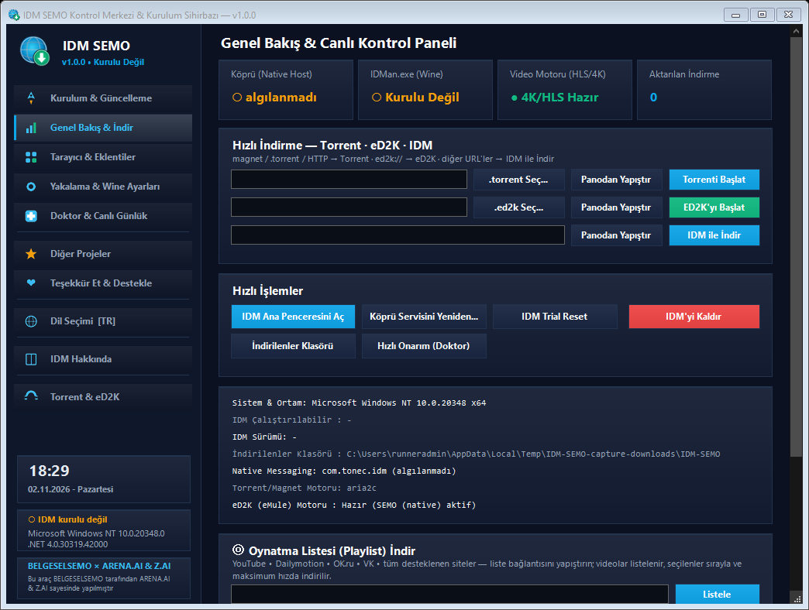</p>
<p align="center">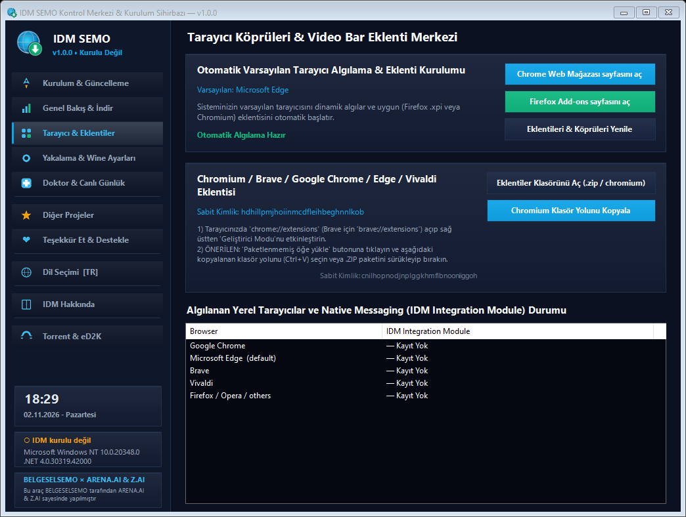</p>
<p align="center">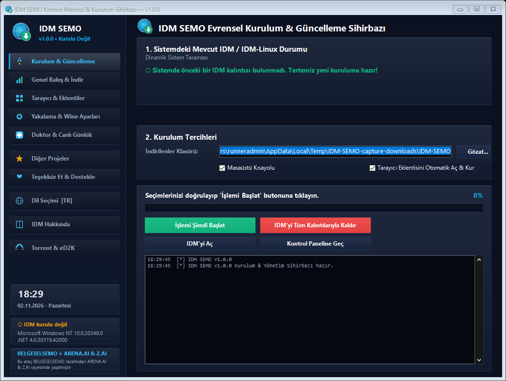</p>
<p align="center">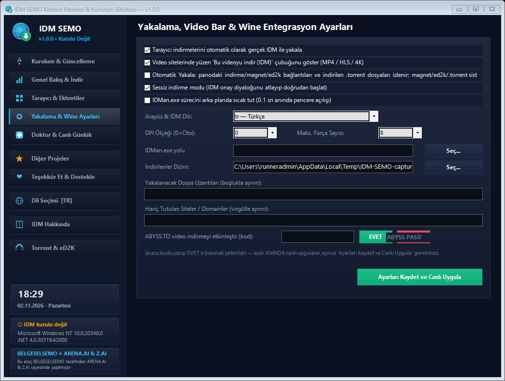</p>
<p align="center">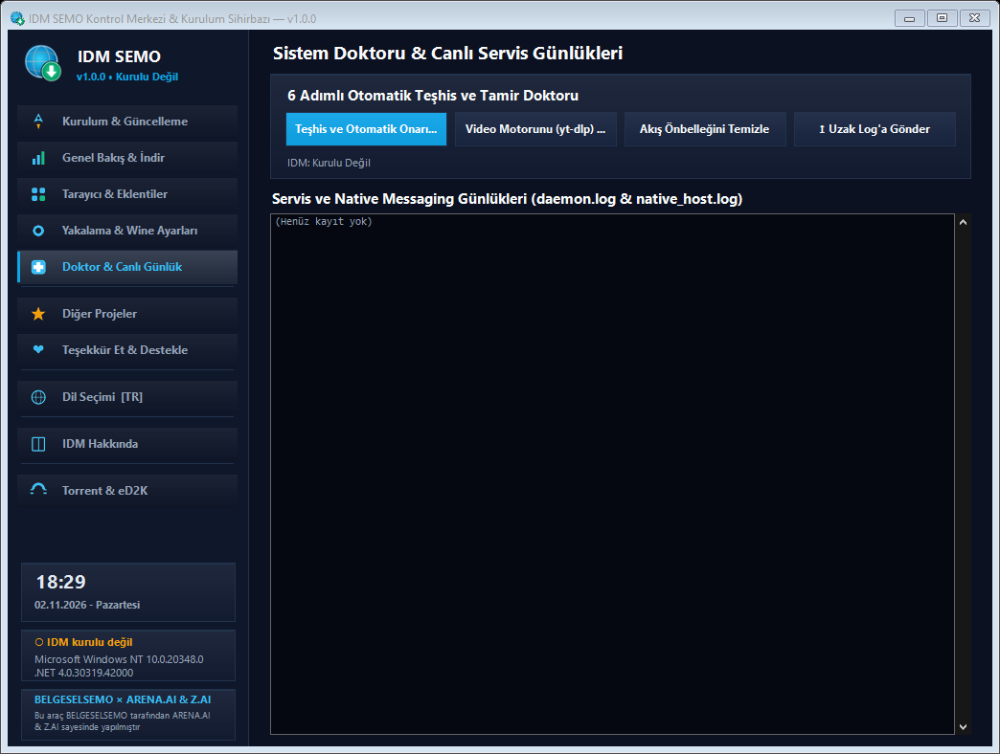</p>
<p align="center">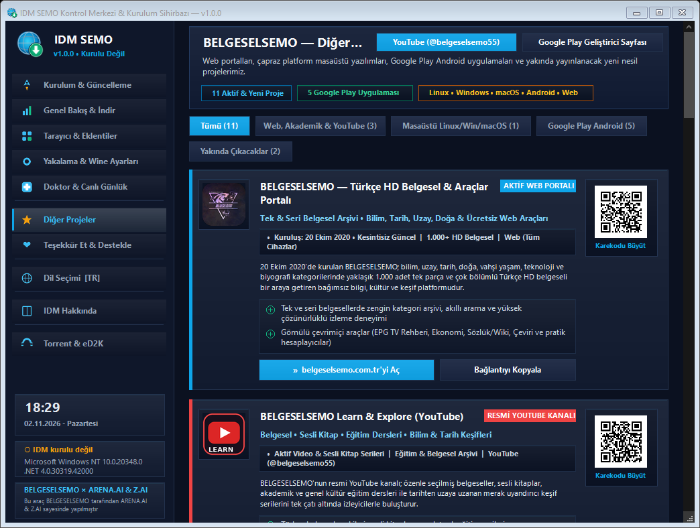</p>
<p align="center">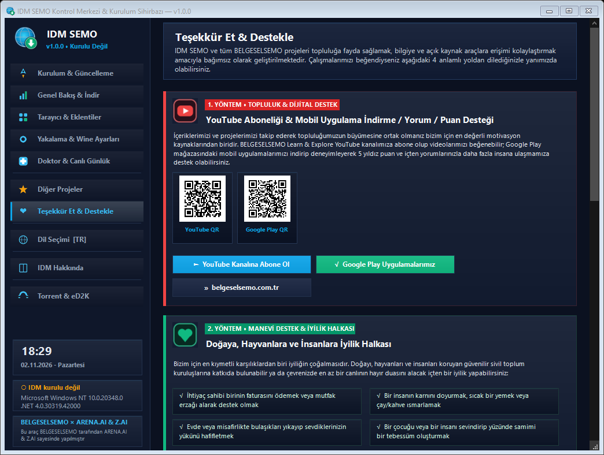</p>
<p align="center">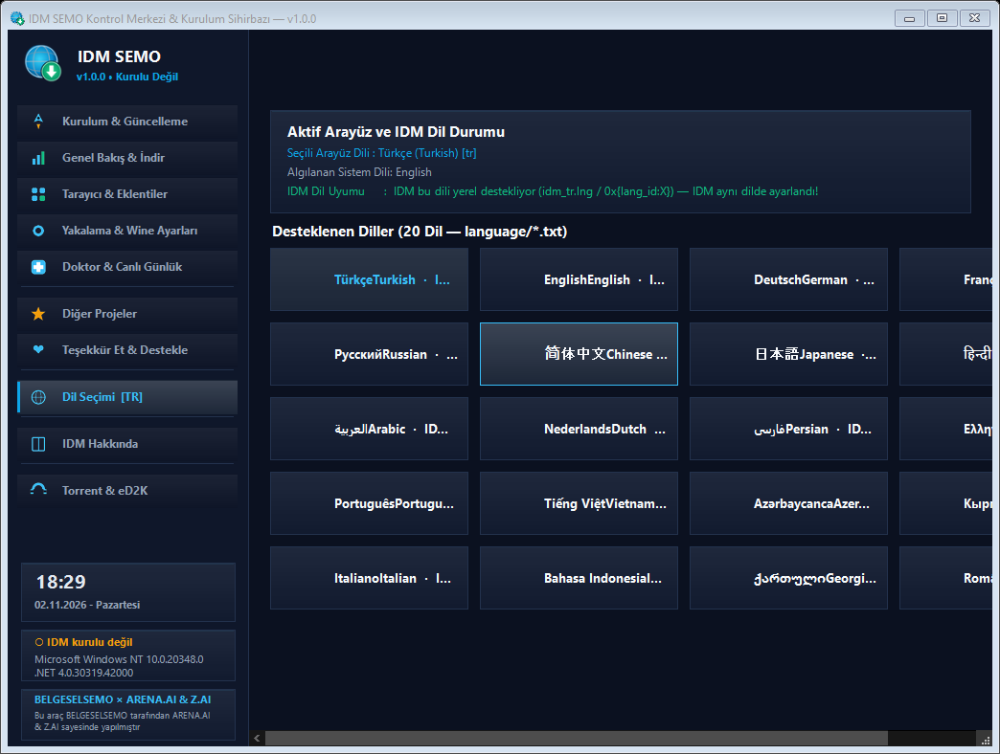</p>
<p align="center">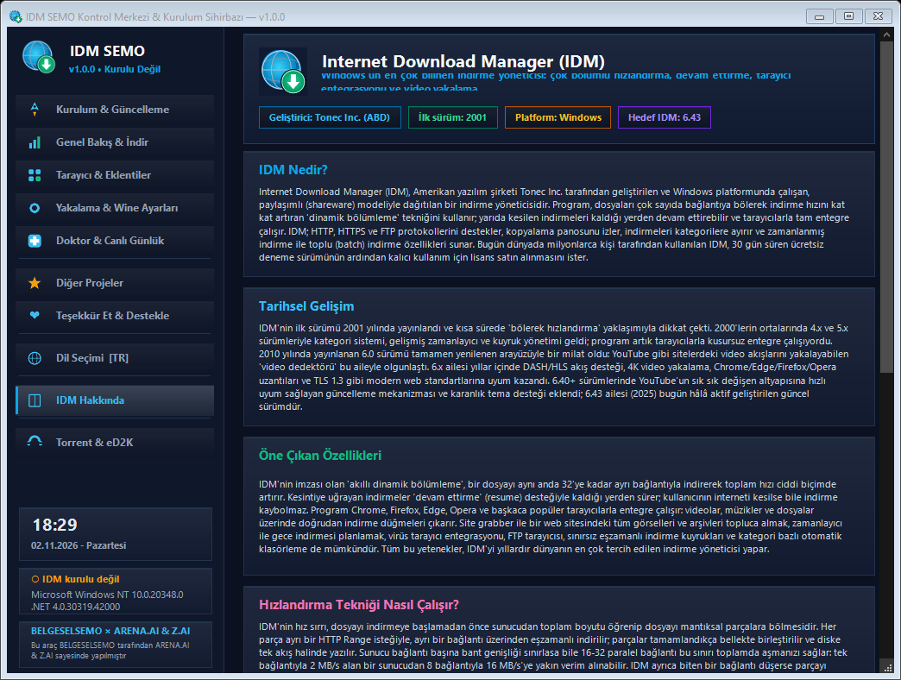</p>
<p align="center">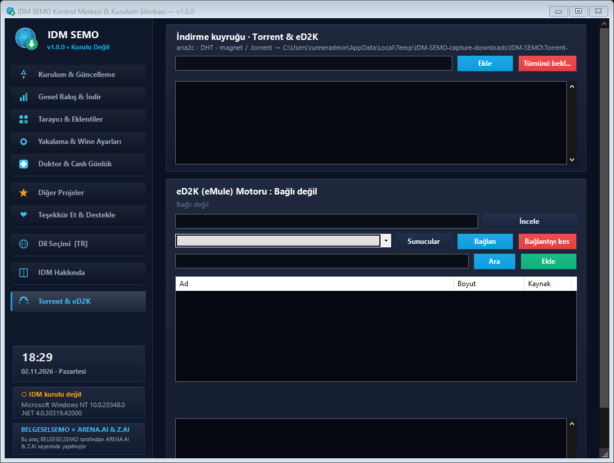</p>

## English

<p align="justify"><strong>IDM SEMO</strong> is an independent native Windows control center for IDM integration, browser bridges, video tools, organized download folders and a user-started torrent/eD2K queue. Unlike IDM LINUX, it does not need Wine. Use the linked product tabs above to return to the complete Linux README.</p>
<p align="justify"><strong>Install:</strong> download the icon-bearing x64 EXE, use the authoritative BAT, or open the one-line CMD section above. The CMD command downloads the current BAT into <code>%TEMP%\idm.bat</code> and executes it; it requires Windows Script Host/VBScript, MSXML and ADODB.Stream. For startup without a CMD/PowerShell shell, choose the EXE.</p>
<p align="justify"><strong>Compatibility:</strong> .NET Framework and compatible bundled engine versions are required. The complete bundle is <strong>not Windows XP compatible</strong>, and not every Windows version has been live-tested. IDM’s own licensing terms apply; no IDM license is provided.</p>
<p align="justify"><strong>Verification:</strong> the images above are real Windows WinForms renders from the production sources on a Windows Server 2022 GitHub Actions runner. They are not download/swarm test evidence. Existing Linux release assets were retained when the Windows EXE was added.</p>

<p align="center"><a href="https://rawgit.loltek.net/https://raw.githubusercontent.com/vesvese55x/IDM-LINUX/refs/heads/main/promo/promo.html">Ortak tanıtım / Both products</a> · <a href="README.md">🐧 IDM LINUX</a> · <a href="https://belgeselsemo.com.tr">BELGESELSEMO</a> · <a href="mailto:semihsy54@gmail.com">semihsy54@gmail.com</a></p>
