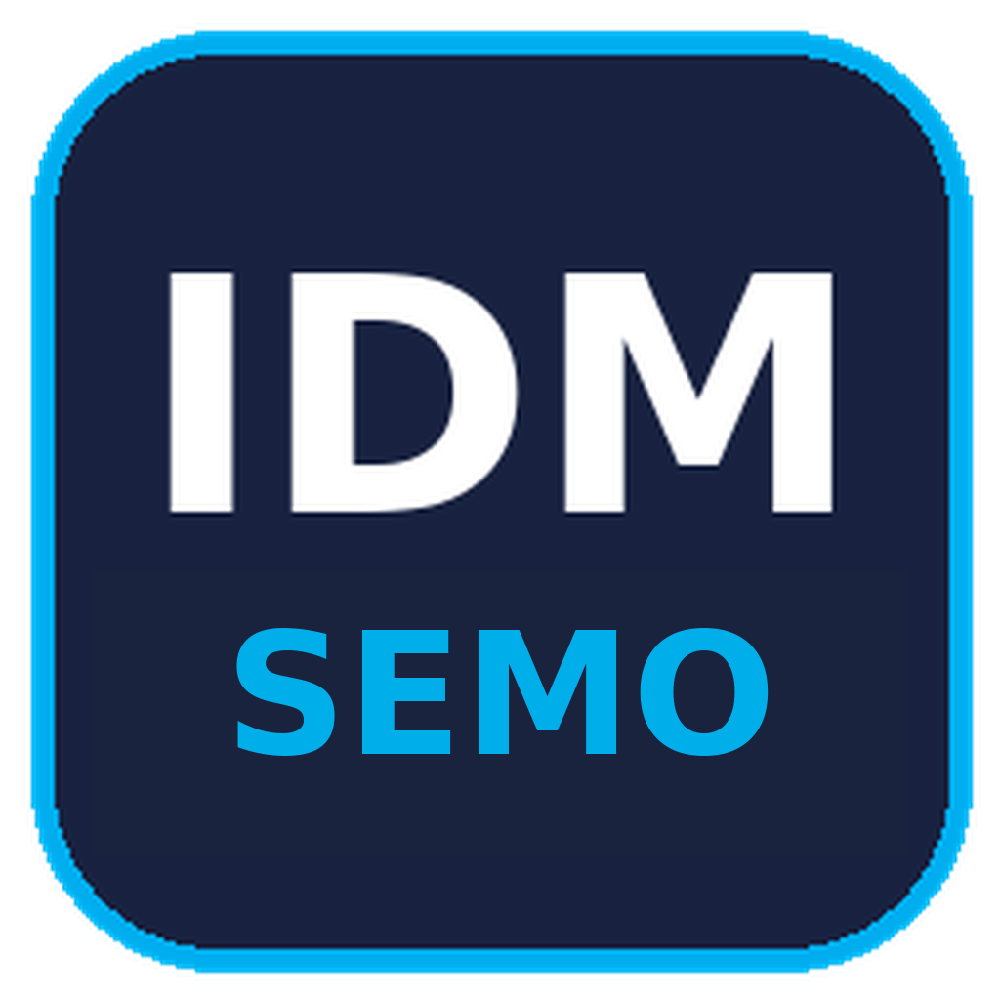
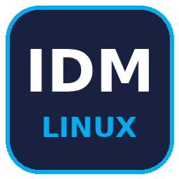
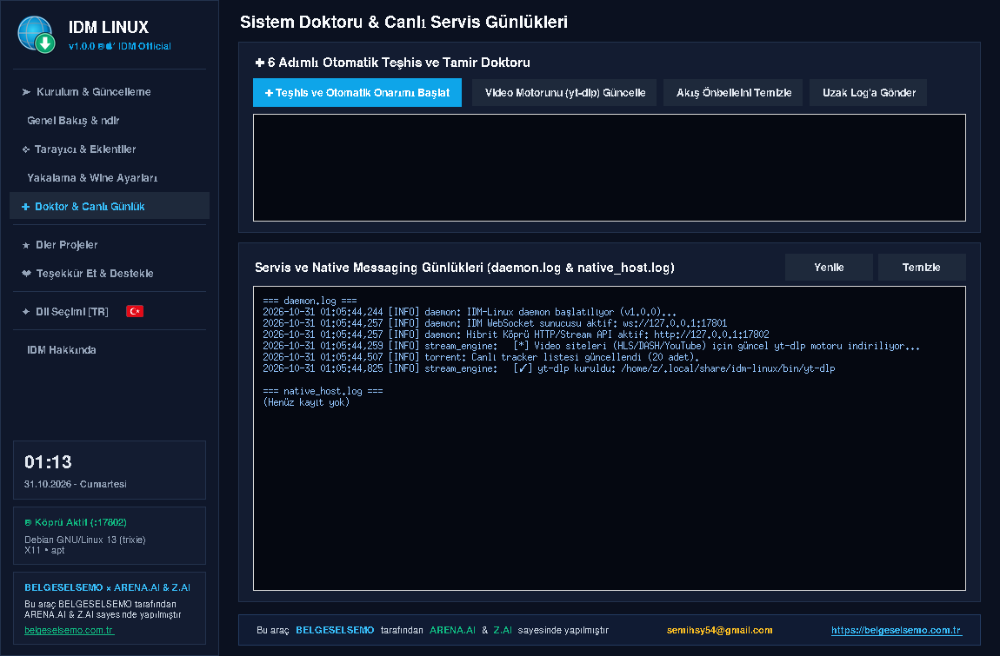
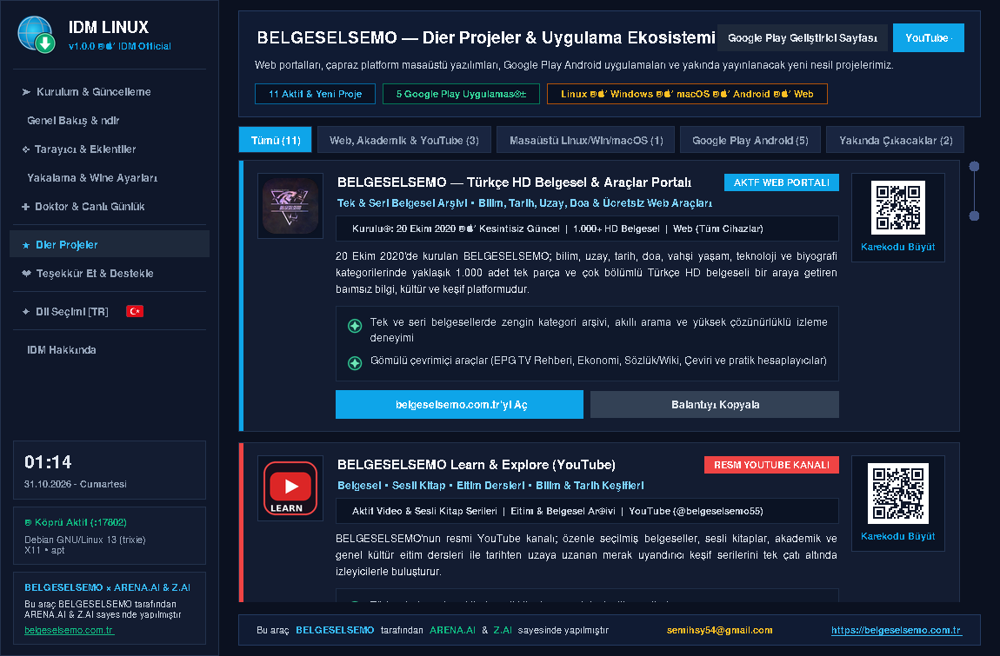
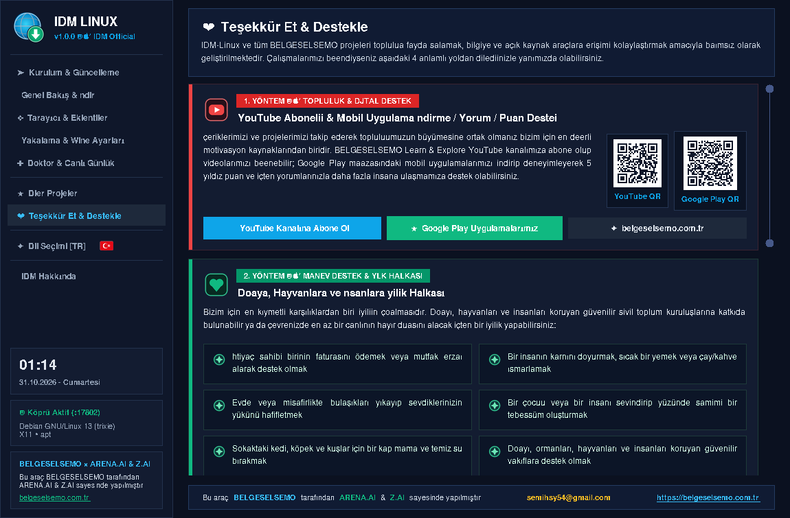
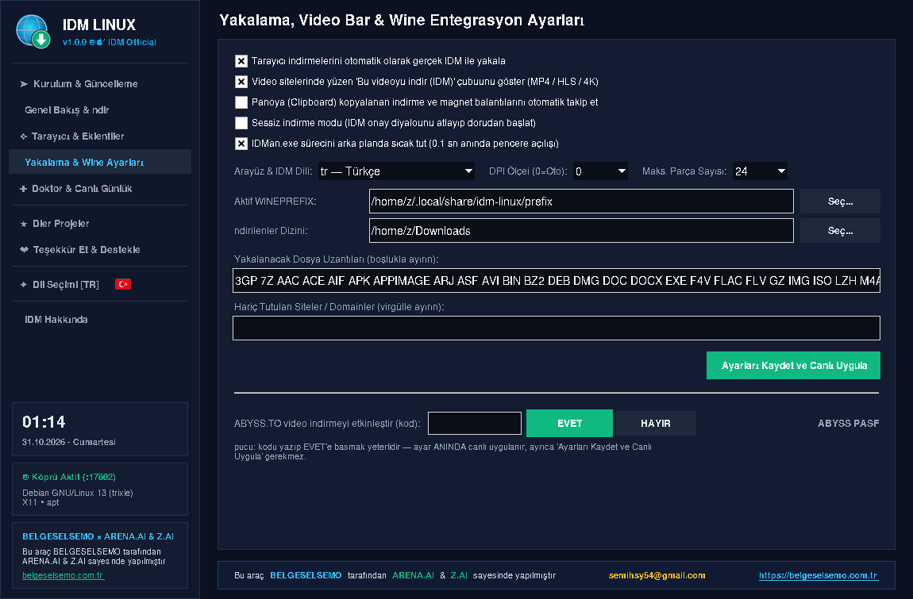

# 🚀 IDM LINUX & IDM SEMO

<p align="center">
  🌐 <strong>Türkçe</strong> ·
  <a href="#english">English</a> ·
  <a href="#deutsch">Deutsch</a> ·
  <a href="#russian">Русский</a> ·
  <a href="#hindi">हिन्दी</a>
</p>

<!-- IDM SEMO card: ordinary selectable text, blue SVG accents on BOTH sides. -->
<table>
<tr>
<td width="10" align="center"></td>
<td>
<p><strong>⊞ IDM SEMO — Windows için IDM kontrol merkezi</strong><br><sub>WINDOWS x64 · YEREL WINFORMS GUI · BAT + EXE + CMD</sub></p>
<p align="justify">IDM entegrasyonu, video araçları ve kullanıcı onaylı torrent/eD2K kuyruğu tek panelde. Kategorili <code>Downloads\IDM-SEMO</code> hedefleri, tek Başlat/Duraklat kontrolü ve komut penceresiz EXE kurulumu.</p>
<p align="center"><a href="https://github.com/vesvese55x/IDM-LINUX/releases/download/v1.0.0/IDM-SEMO-1.0.0-x86_64.exe"><strong>⬇ Windows EXE indir</strong></a> · <a href="README-SEMO.md"><strong>⊞ SEMO rehberini aç</strong></a> · <a href="#windows-cmd-kurulum">⌨ CMD ile kur</a> · <a href="https://rawgit.loltek.net/https://raw.githubusercontent.com/vesvese55x/IDM-LINUX/refs/heads/main/promo/promo.html">↗ Tanıtım</a></p>
<p align="justify"><sub>Bağımsız bir entegrasyon/kontrol katmanıdır; IDM lisansı sağlamaz. EXE .NET Framework gerektirir. Paket genelinde %100 Windows XP uyumu yoktur.</sub></p>
</td>
<td width="10" align="center"></td>
</tr>
</table>

<table align="center"><tr><td align="center"><strong>🔵 🐧 IDM LINUX · Linux</strong></td><td align="center"><a href="README-SEMO.md"><strong>⊞ IDM SEMO · Windows →</strong></a></td></tr></table>
<p align="center"><sub>GitHub uyumlu bağlantılı ürün sekmeleri / Linked product tabs: Linux · Windows</sub></p>

<a id="windows-cmd-kurulum"></a>
<details>
<summary><strong>⌨ Windows CMD ile tek satırda IDM SEMO kurulumu / One-line CMD install</strong></summary>

<p align="justify">Windows’ta <strong>Komut İstemi’ni (CMD)</strong> açın, aşağıdaki komutu tek satır olarak yapıştırıp Enter’a basın. Komut, resmî repodaki güncel BAT’ı <code>%TEMP%\idm.bat</code> yoluna indirip çalıştırır.</p>

```cmd
echo Set x=CreateObject("MSXML2.XMLHTTP"):x.Open "GET","https://raw.githubusercontent.com/vesvese55x/IDM-LINUX/main/belgeselsemo-idm-windows-installer.bat",0:x.Send:Set s=CreateObject("ADODB.Stream"):s.Open:s.Type=1:s.Write x.responseBody:s.SaveToFile "%TEMP%\idm.bat",2 > "%TEMP%\d.vbs" & echo. & echo [i] Indiriliyor... / Downloading... & cscript //nologo "%TEMP%\d.vbs" & echo [+] Tamamlandi! / Completed! & call "%TEMP%\idm.bat"
```

<p align="justify"><strong>Gereksinim:</strong> Windows Script Host / VBScript, MSXML ve ADODB.Stream erişimi. VBScript/WSH bazı güncel veya kurum tarafından yönetilen sistemlerde kapalı olabilir; bu durumda EXE’yi kullanın. Bu CMD alternatifi komut penceresi gösterir; <strong>komut penceresiz açılış için EXE</strong> önerilir.</p>
<p align="justify"><strong>Güven:</strong> Bu komut internetten indirdiği betiği doğrudan çalıştırır. Yalnızca resmî repoya güveniyorsanız kullanın. “Completed” satırı kurulumun başarılı olduğunu garanti etmez; indirme/WSH hatası varsa devam etmeyin ve eski <code>%TEMP%\idm.bat</code> dosyasına güvenmeyin.</p>

</details>


<p align="center">
  &nbsp;&nbsp;
</p>

<p align="justify">
  <strong>IDM LINUX</strong>, Tonec Inc.'in efsanevi indirme yöneticisi <strong>Internet Download Manager</strong>'ın tüm gücünü Linux'a taşıyan bağımsız bir entegrasyon katmanıdır. Tarayıcı yakalama, video siteleri, torrent ve canlı yayın DVR katmanları tek bir hafif kontrol panelinde birleşir; indirmeler gerçek IDM motoru üzerinden maksimum hızda yürür.
</p>

<p align="center">
  <a href="https://rawgit.loltek.net/https://raw.githubusercontent.com/vesvese55x/IDM-LINUX/refs/heads/main/promo/promo.html" target="_blank" rel="noreferrer"><strong>TANITIM SUNUMU</strong></a>
  ·
  <a href="https://htmlpreview.github.io/?https://github.com/vesvese55x/IDM-LINUX/blob/main/promo/promo.html" target="_blank" rel="noreferrer"><strong>TANITIM YEDEK LİNK</strong></a>
  ·
  <a href="https://belgeselsemo.com.tr" target="_blank" rel="noreferrer"><strong>BELGESELSEMO.COM.TR</strong></a>
  ·
  <a href="https://github.com/vesvese55x/IDM-LINUX" target="_blank" rel="noreferrer"><strong>GITHUB</strong></a>
</p>

> ⚡ **Tek satırlık otomatik kurulum / One-line auto install**
>
> `curl -fsSL https://raw.githubusercontent.com/vesvese55x/IDM-LINUX/refs/heads/main/belgeselsemo-idm-linux-installer | sh`


## IDM deneyimi Linux'ta

<p align="justify">IDM LINUX; Wine üzerinde koşan gerçek IDM motorunu, Linux tarafında hafif bir Python kontrol paneliyle buluşturur. Kurulum sihirbazı Wine ortamını ve resmî IDM kurulumunu otomatik hazırlar; Genel Bakış ekranı köprü durumunu, video motorunu ve hızlı indirme araçlarını tek ekranda gösterir. Hızlı bağlantı kutusuna URL, magnet veya yerel .torrent dosyası bırakmanız yeterli — gerisini IDM LINUX halleder.</p>

<p align="center">
  
</p>

## İndirme katmanları

✨ <strong>Tarayıcı entegrasyonu</strong> — Chromium ve Firefox tabanlı tüm tarayıcılarda eklenti; indirme taleplerini otomatik yakalar ve IDM'ye devreder.  
🎬 <strong>Video motoru (HLS/4K)</strong> — yt-dlp / streamlink zinciriyle video siteleri; en uygun motor otomatik seçilir, akış doğrudan IDM'ye aktarılır.  
🧲 <strong>Gömülü torrent motoru</strong> — magnet ve .torrent desteği, DHT ile tracker'sız peer keşfi; onay penceresinden içerik ya da yalnızca .torrent dosyası indirme.  
📦 <strong>Dosya barındırıcılar</strong> — popüler barındırıcı siteler için konuk oturumu ve doğrudan bağlantı çözümleme; dosya bozuk inmez.  
📺 <strong>Canlı yayın / DVR kaydı</strong> — canlı akışlardan kayıt alabilen DVR katmanı, arayüzden yönetilir.  
📜 <strong>Oynatma listesi</strong> — YouTube/Dailymotion vb. liste bağlantısını yapıştırın; videolar listelenir, seçilenler sırayla indirilir.

<p align="center">
  
  
</p>

## Sistem Doktoru ve canlı günlükler

<p align="justify">Sorun anında kaynağı tahmin etmeye gerek yok: 6 adımlı otomatik teşhis ve tamir doktoru köprüyü, video motorunu ve tarayıcı bağlantılarını tek tıkla onarır. daemon.log ve native_host.log canlı günlükleri aynı ekranda akar; uzak log gönderimiyle destek ekibine tek tıkla paylaşılır. "İptal = tam dur" ilkesi sayesinde herhangi bir indirmeyi iptal ettiğinizde arka planda hiçbir motor devam etmez.</p>

<p align="center">
  
</p>

## Python paket testleri — kalite kapısı

<p align="justify">IDM LINUX'un Python paketi, 208 testten oluşan bir test süitiyle korunur. Süit; ED2K çerçeveleme ve peer iletişimi, gömülü P2P motoru (bencode, DHT, tracker), kurulum akışı, keşif determinizmi ve sürüm düzeltmelerini kapsayan birim testleri içerir. Bu test süiti her push'ta GitHub Actions üzerinde <strong>kalite kapısı</strong> olarak çalışır: testler geçmeden 4'lü paket derlemesi (AppImage / deb / rpm / zst) başlamaz, böylece hiçbir sürüm testten geçmeyen bir kodla yayınlanmaz. Tüm süiti tek satırla çalıştırabilirsiniz:</p>

<p align="center"><code>python -m pytest src/idm_linux/tests -q</code></p>

## BELGESELSEMO ekosistemi, dil desteği ve destek

<p align="justify">IDM LINUX, BELGESELSEMO evreninin masaüstü parçasıdır: web portalları, YouTube kanalı, Google Play uygulamaları ve yardımcı araçlar aynı ekosistemi paylaşır. Arayüz 20 dilde çalışır (varsayılan Türkçe); destek sayfasından YouTube aboneliği, Google Play puanı veya bağış yollarıyla projelere katkı verilebilir.</p>

<p align="center">
  
  
</p>

## Kişiselleştirme ve ayarlar

<p align="justify">Köprü portları, indirme klasörü, Wine önek konumu, arayüz dili ve tarayıcı yakalama davranışı tek ekrandan yönetilir. `--no-sandbox` gerektiren ortamlar dinamik olarak algılanır; kurulum sırasında ve tarayıcı açılışlarında gerekli parametre otomatik eklenir; `--no-sandbox` engeli kökten kaldırılır.</p>

<p align="center">
  
</p>

## Platform paketleri ve kurulum komutları

⚡ <strong>Tek satırda otomatik kurulum</strong> — betik dağıtımınızı algılar (Debian/Ubuntu/Mint, Fedora/openSUSE/RHEL, Arch/Manjaro/Cachy OS ve türevleri; tanımayan sistemlerde AppImage), GitHub Releases'teki <em>en güncel</em> paketi indirip kurar:

<p align="center"><code>curl -fsSL https://raw.githubusercontent.com/vesvese55x/IDM-LINUX/refs/heads/main/belgeselsemo-idm-linux-installer | sh</code></p>

<table>
  <tr>
    <td><strong>Paket</strong></td>
    <td><strong>Ne için?</strong></td>
    <td><strong>Kurulum / Çalıştırma komutu</strong></td>
    <td><strong>İndir</strong></td>
  </tr>
  <tr>
    <td>📦 <strong>AppImage</strong></td>
    <td>Kurulum gerektirmez; indir, çalıştırılabilir yap, çift tıkla</td>
    <td><code>chmod +x IDM-LINUX-1.0.0-x86_64.AppImage &amp;&amp; ./IDM-LINUX-1.0.0-x86_64.AppImage</code></td>
    <td align="center"><a href="https://github.com/vesvese55x/IDM-LINUX/releases/latest/download/IDM-LINUX-1.0.0-x86_64.AppImage" target="_blank" rel="noreferrer"></a></td>
  </tr>
  <tr>
    <td>🐧 <strong>deb</strong></td>
    <td>Debian / Ubuntu / Mint ve türevleri; gdebi gibi GUI yükleyicilerle de uyumlu</td>
    <td><code>sudo apt install ./idm-linux_1.0.0_all.deb</code></td>
    <td align="center"><a href="https://github.com/vesvese55x/IDM-LINUX/releases/latest/download/idm-linux_1.0.0_all.deb" target="_blank" rel="noreferrer"></a></td>
  </tr>
  <tr>
    <td>🎩 <strong>rpm</strong></td>
    <td>Fedora / openSUSE / RHEL türevleri</td>
    <td><code>sudo dnf install ./idm-linux-1.0.0-1.noarch.rpm</code></td>
    <td align="center"><a href="https://github.com/vesvese55x/IDM-LINUX/releases/latest/download/idm-linux-1.0.0-1.noarch.rpm" target="_blank" rel="noreferrer"></a></td>
  </tr>
  <tr>
    <td>🏔️ <strong>zst</strong></td>
    <td>Arch / Manjaro / Cachy OS ve türevleri</td>
    <td><code>sudo pacman -U idm-linux-1.0.0-1-any.pkg.tar.zst</code></td>
    <td align="center"><a href="https://github.com/vesvese55x/IDM-LINUX/releases/latest/download/idm-linux-1.0.0-1-any.pkg.tar.zst" target="_blank" rel="noreferrer"></a></td>
  </tr>
</table>

<p align="center">
  
  
  
  
  
  
  
  
</p>

🌟 Tablodaki <strong>İNDİR</strong> butonları her zaman [GitHub Releases](https://github.com/vesvese55x/IDM-LINUX/releases/latest) sayfasındaki <em>en güncel</em> paketi indirir; tüm paketler aynı <strong>IDM-LINUX-1.0.0</strong> sürümünü taşır.  
🧰 Kurulum sihirbazı; Wine, resmî IDM, tarayıcı eklentileri ve yt-dlp/ffmpeg/aria2 araçlarını gerektiğinde otomatik indirip kurar.  
🧩 Gereksinimler: Linux (x86_64 önerilir) ve Python 3.8+; masaüstü ortamı (X11/Wayland) GUI için önerilir.  
🌐 Arayüz 20 dilde çalışır; Türkçe varsayılan olarak gelir.

## Mobil BELGESELSEMO ekosistemi

<p align="justify">BELGESELSEMO dünyası masaüstüyle sınırlı değildir. Android tarafında da belgesel, trivia, TV rehberi, nöbetçi eczane, Nutuk ve ekonomi odaklı uygulama katmanları aynı ekosistemi sürdürür.</p>

<table>
  <tr>
    <td align="center" width="33%">
      <a href="https://play.google.com/store/apps/details?id=com.belgeselsemo.tr" target="_blank" rel="noreferrer">
        <br>
        <strong>BELGESELSEMO</strong>
      </a>
    </td>
    <td align="center" width="33%">
      <a href="https://play.google.com/store/apps/details?id=com.belgeselsemo.trivia" target="_blank" rel="noreferrer">
        <br>
        <strong>BELGESELSEMO TRIVIA</strong>
      </a>
    </td>
    <td align="center" width="33%">
      <a href="https://play.google.com/store/apps/details?id=com.belgeselsemo.epgviewer" target="_blank" rel="noreferrer">
        <br>
        <strong>BELGESELSEMO TV REHBERİ (EPG)</strong>
      </a>
    </td>
  </tr>
  <tr>
    <td align="center" width="33%">
      <a href="https://play.google.com/store/apps/details?id=com.belgeselsemo.nb724" target="_blank" rel="noreferrer">
        <br>
        <strong>NÖBETÇİ ECZANELER 7/24 TR-KKTC</strong>
      </a>
    </td>
    <td align="center" width="33%">
      <a href="https://play.google.com/store/apps/details?id=com.belgeselsemo.nutuk" target="_blank" rel="noreferrer">
        <br>
        <strong>NUTUK 1919-1927</strong>
      </a>
    </td>
    <td align="center" width="33%">
      <strong>BELGESELSEMO ECONOMY</strong><br>
      <sub>Yakında</sub>
    </td>
  </tr>
</table>

## Tanıtım sunumu

<p align="justify">Repo içinde uygulamayı daha zengin ve sunum odaklı şekilde anlatan ayrı bir tanıtım sayfası bulunur:</p>

🌐 Canlı tanıtım: <a href="https://rawgit.loltek.net/https://raw.githubusercontent.com/vesvese55x/IDM-LINUX/refs/heads/main/promo/promo.html" target="_blank" rel="noreferrer">rawgit.loltek.net</a>  
🛟 Yedek tanıtım: <a href="https://htmlpreview.github.io/?https://github.com/vesvese55x/IDM-LINUX/blob/main/promo/promo.html" target="_blank" rel="noreferrer">htmlpreview.github.io</a>  
🪂 Ek yedek: <a href="https://gh.maple3142.workers.dev/vesvese55x/IDM-LINUX/main/promo/promo.html" target="_blank" rel="noreferrer">gh.maple3142.workers.dev</a>  
📁 Repo içi dosya: <a href="promo/promo.html" target="_blank" rel="noreferrer">promo/promo.html</a>

<p align="justify">Bu sayfa; ekranlar, indirme katmanları, sistem araçları, platform paketleri ve mobil ekosistemle birlikte <strong>tüm özellikleri ve işlevselliğiyle IDM LINUX deneyimini tek sahnede anlatır</strong>.</p>

---

<a id="english"></a>
## 🌐 English

<details open>
<summary><strong>Full README in English — click to expand / collapse</strong></summary>

<h2>IDM experience on Linux</h2>

<p align="justify"><strong>IDM LINUX</strong> brings the full power of Tonec Inc.'s legendary download manager <strong>Internet Download Manager</strong> to Linux as an independent integration layer. Browser capture, video sites, torrent and live-stream DVR layers come together in a single lightweight control panel; downloads run at maximum speed on the real IDM engine. The setup wizard prepares the Wine environment and the official IDM installation automatically; the Overview screen shows bridge status, video engine and quick-download tools in one place.</p>

<p align="center"></p>

<h2>Download layers</h2>

✨ <strong>Browser integration</strong> — extension for all Chromium- and Firefox-based browsers; captures download requests automatically and hands them to IDM.  
🎬 <strong>Video engine (HLS/4K)</strong> — yt-dlp / streamlink chain for video sites; the best engine is picked automatically and the stream is passed straight to IDM.  
🧲 <strong>Built-in torrent engine</strong> — magnet and .torrent support, tracker-less peer discovery via DHT; download full content or only the .torrent file.  
📦 <strong>File hosters</strong> — guest sessions and direct-link resolution for popular hosting sites; files never arrive corrupted.  
📺 <strong>Live stream / DVR recording</strong> — a DVR layer that records live streams, managed from the UI.  
📜 <strong>Playlists</strong> — paste a YouTube/Dailymotion playlist link; videos are listed and selected ones download in order.

<h2>System Doctor and live logs</h2>

<p align="justify">No need to guess the cause of a problem: the 6-step automatic diagnosis-and-repair doctor fixes the bridge, video engine and browser connections with one click. daemon.log and native_host.log live logs stream on the same screen and can be shared with the support team via remote log upload. Thanks to the "cancel = full stop" principle, no engine keeps running in the background after you cancel a download.</p>

<h2>Python package tests — quality gate</h2>

<p align="justify">The IDM LINUX Python package is protected by a test suite of 208 tests covering ED2K framing and peer communication, the embedded P2P engine (bencode, DHT, tracker), the installation flow, discovery determinism and release fixes. On every push the suite runs on GitHub Actions as a <strong>quality gate</strong>: the 4-package build (AppImage / deb / rpm / zst) only starts after all tests pass, so no release ships with untested code. Run the whole suite with one line:</p>

<p align="center"><code>python -m pytest src/idm_linux/tests -q</code></p>

<h2>Platform packages and install commands</h2>

⚡ <strong>One-line auto install</strong> — the script detects your distribution (Debian/Ubuntu/Mint, Fedora/openSUSE/RHEL, Arch/Manjaro/Cachy OS and derivatives; AppImage on unknown systems), downloads the <em>latest</em> package from GitHub Releases and installs it:

<p align="center"><code>curl -fsSL https://raw.githubusercontent.com/vesvese55x/IDM-LINUX/refs/heads/main/belgeselsemo-idm-linux-installer | sh</code></p>

<table>
  <tr><td><strong>Package</strong></td><td><strong>For whom?</strong></td><td><strong>Install / run command</strong></td></tr>
  <tr><td>📦 <strong>AppImage</strong></td><td>No installation; download, make executable, double-click</td><td><code>chmod +x IDM-LINUX-1.0.0-x86_64.AppImage &amp;&amp; ./IDM-LINUX-1.0.0-x86_64.AppImage</code></td></tr>
  <tr><td>🐧 <strong>deb</strong></td><td>Debian / Ubuntu / Mint and derivatives; also works with gdebi-style GUI installers</td><td><code>sudo apt install ./idm-linux_1.0.0_all.deb</code></td></tr>
  <tr><td>🎩 <strong>rpm</strong></td><td>Fedora / openSUSE / RHEL derivatives</td><td><code>sudo dnf install ./idm-linux-1.0.0-1.noarch.rpm</code></td></tr>
  <tr><td>🏔️ <strong>zst</strong></td><td>Arch / Manjaro / Cachy OS and derivatives</td><td><code>sudo pacman -U idm-linux-1.0.0-1-any.pkg.tar.zst</code></td></tr>
</table>

🌟 All packages carry the same <strong>IDM-LINUX-1.0.0</strong> release and are downloaded from [GitHub Releases](https://github.com/vesvese55x/IDM-LINUX/releases/tag/v1.0.0).  
🧩 Requirements: Linux (x86_64 recommended) and Python 3.8+; a desktop environment (X11/Wayland) is recommended for the GUI.  
🌐 The UI works in 20 languages; Turkish is the default.

<h2>Presentation</h2>

<p align="justify">A separate, presentation-focused page inside the repo tells the whole IDM LINUX experience — screens, download layers, system tools, platform packages and the mobile ecosystem — in a single scene: <a href="https://rawgit.loltek.net/https://raw.githubusercontent.com/vesvese55x/IDM-LINUX/refs/heads/main/promo/promo.html" target="_blank" rel="noreferrer">promo.html (live)</a> · <a href="promo/promo.html" target="_blank" rel="noreferrer">in-repo file</a>.</p>

</details>

---

<a id="deutsch"></a>
## 🌐 Deutsch

<details>
<summary><strong>Vollständige README auf Deutsch — zum Auf- und Zuklappen klicken</strong></summary>

<h2>IDM-Erlebnis unter Linux</h2>

<p align="justify"><strong>IDM LINUX</strong> bringt die volle Kraft von Tonec Inc.' legendärem Download-Manager <strong>Internet Download Manager</strong> als unabhängige Integrationsschicht auf Linux. Browser-Erfassung, Videoseiten, Torrent- und Live-Stream-DVR-Ebenen vereinen sich in einem einzigen schlanken Kontrollzentrum; Downloads laufen mit maximaler Geschwindigkeit über die echte IDM-Engine. Der Installationsassistent bereitet die Wine-Umgebung und die offizielle IDM-Installation automatisch vor.</p>

<p align="center"></p>

<h2>Download-Ebenen</h2>

✨ <strong>Browser-Integration</strong> — Erweiterung für alle Chromium- und Firefox-basierten Browser; erfasst Download-Anfragen automatisch und übergibt sie an IDM.  
🎬 <strong>Video-Engine (HLS/4K)</strong> — yt-dlp-/streamlink-Kette für Videoseiten; die beste Engine wird automatisch gewählt, der Stream geht direkt an IDM.  
🧲 <strong>Eingebettete Torrent-Engine</strong> — Magnet- und .torrent-Unterstützung, Tracker-loses Peer-Finding über DHT; Inhalt oder nur die .torrent-Datei laden.  
📦 <strong>Datei-Hoster</strong> — Gastsitzungen und Direktlink-Auflösung für beliebte Hoster; Dateien kommen nie beschädigt an.  
📺 <strong>Live-Stream / DVR-Aufnahme</strong> — eine DVR-Ebene für Live-Streams, gesteuert aus der Oberfläche.  
📜 <strong>Wiedergabelisten</strong> — YouTube-/Dailymotion-Listenlink einfügen; Videos werden aufgelistet und ausgewählte nacheinander geladen.

<h2>System-Doktor und Live-Logs</h2>

<p align="justify">Kein Rätselraten bei Problemen: Der 6-stufige automatische Diagnose- und Reparatur-Doktor repariert Brücke, Video-Engine und Browser-Verbindungen mit einem Klick. daemon.log und native_host.log laufen live im selben Fenster und lassen sich per Fern-Log-Upload an das Support-Team teilen. Nach dem Prinzip „Abbrechen = Vollstopp" läuft nach dem Abbrechen eines Downloads keine Engine im Hintergrund weiter.</p>

<h2>Python-Paket-Tests — Qualitätstor</h2>

<p align="justify">Das Python-Paket von IDM LINUX wird von einer Testsuite mit 208 Tests geschützt: ED2K-Framing und Peer-Kommunikation, die eingebettete P2P-Engine (bencode, DHT, Tracker), der Installationsablauf, Erkennungs-Determinismus und Release-Fixes. Bei jedem Push läuft die Suite auf GitHub Actions als <strong>Qualitätstor</strong>: Der 4-Paket-Build (AppImage / deb / rpm / zst) startet erst, wenn alle Tests bestehen — kein Release mit ungetestetem Code. Die gesamte Suite läuft mit einer Zeile:</p>

<p align="center"><code>python -m pytest src/idm_linux/tests -q</code></p>

<h2>Plattformpakete und Installationsbefehle</h2>

⚡ <strong>Auto-Installation in einer Zeile</strong> — das Skript erkennt Ihre Distribution (Debian/Ubuntu/Mint, Fedora/openSUSE/RHEL, Arch/Manjaro/Cachy OS und Derivate; AppImage auf unbekannten Systemen), lädt das <em>neueste</em> Paket aus GitHub Releases und installiert es:

<p align="center"><code>curl -fsSL https://raw.githubusercontent.com/vesvese55x/IDM-LINUX/refs/heads/main/belgeselsemo-idm-linux-installer | sh</code></p>

<table>
  <tr><td><strong>Paket</strong></td><td><strong>Für wen?</strong></td><td><strong>Installations-/Startbefehl</strong></td></tr>
  <tr><td>📦 <strong>AppImage</strong></td><td>Ohne Installation; herunterladen, ausführbar machen, doppelklicken</td><td><code>chmod +x IDM-LINUX-1.0.0-x86_64.AppImage &amp;&amp; ./IDM-LINUX-1.0.0-x86_64.AppImage</code></td></tr>
  <tr><td>🐧 <strong>deb</strong></td><td>Debian / Ubuntu / Mint und Derivate; auch mit GUI-Installern wie gdebi kompatibel</td><td><code>sudo apt install ./idm-linux_1.0.0_all.deb</code></td></tr>
  <tr><td>🎩 <strong>rpm</strong></td><td>Fedora / openSUSE / RHEL-Derivate</td><td><code>sudo dnf install ./idm-linux-1.0.0-1.noarch.rpm</code></td></tr>
  <tr><td>🏔️ <strong>zst</strong></td><td>Arch / Manjaro / Cachy OS und Derivate</td><td><code>sudo pacman -U idm-linux-1.0.0-1-any.pkg.tar.zst</code></td></tr>
</table>

🌟 Alle Pakete tragen dieselbe <strong>IDM-LINUX-1.0.0</strong>-Version und werden von [GitHub Releases](https://github.com/vesvese55x/IDM-LINUX/releases/tag/v1.0.0) geladen.  
🧩 Voraussetzungen: Linux (x86_64 empfohlen) und Python 3.8+; eine Desktop-Umgebung (X11/Wayland) wird für die GUI empfohlen.  
🌐 Die Oberfläche ist in 20 Sprachen verfügbar; Türkisch ist die Standardsprache.

</details>

---

<a id="russian"></a>
## 🌐 Русский

<details>
<summary><strong>Полная README на русском — нажмите, чтобы раскрыть / свернуть</strong></summary>

<h2>Опыт IDM на Linux</h2>

<p align="justify"><strong>IDM LINUX</strong> переносит всю мощь легендарного менеджера загрузок <strong>Internet Download Manager</strong> от Tonec Inc. на Linux в виде независимого интеграционного слоя. Захват из браузера, видеосайты, torrent- и DVR-слои live-трансляций объединяются в единой лёгкой панели управления; загрузки идут на максимальной скорости через настоящий движок IDM. Мастер установки автоматически подготавливает среду Wine и официальную установку IDM.</p>

<p align="center"></p>

<h2>Слои загрузки</h2>

✨ <strong>Интеграция с браузерами</strong> — расширение для всех браузеров на Chromium и Firefox; автоматически перехватывает запросы на загрузку и передаёт их в IDM.  
🎬 <strong>Видеодвижок (HLS/4K)</strong> — цепочка yt-dlp / streamlink для видеосайтов; оптимальный движок выбирается автоматически, поток передаётся прямо в IDM.  
🧲 <strong>Встроенный torrent-движок</strong> — поддержка magnet и .torrent, поиск пиров без трекеров через DHT; скачивание содержимого или только .torrent-файла.  
📦 <strong>Файлообменники</strong> — гостевые сессии и разрешение прямых ссылок для популярных хостингов; файлы не приходят повреждёнными.  
📺 <strong>Live-трансляции / запись DVR</strong> — DVR-слой для записи live-потоков, управляется из интерфейса.  
📜 <strong>Плейлисты</strong> — вставьте ссылку на плейлист YouTube/Dailymotion; видео перечисляются, выбранные скачиваются по очереди.

<h2>Системный доктор и живые журналы</h2>

<p align="justify">Не нужно гадать о причине проблемы: 6-шаговый автоматический доктор диагностики и ремонта чинит мост, видеодвижок и подключения браузеров одним кликом. Живые журналы daemon.log и native_host.log текут на том же экране и передаются команде поддержки удалённой отправкой логов. Благодаря принципу «отмена = полная остановка» после отмены загрузки ни один движок не продолжает работу в фоне.</p>

<h2>Тесты Python-пакета — ворота качества</h2>

<p align="justify">Python-пакет IDM LINUX защищён набором из 208 тестов: ED2K-фрейминг и связь с пирами, встроенный P2P-движок (bencode, DHT, трекер), процесс установки, детерминизм обнаружения и исправления релизов. При каждом push набор запускается на GitHub Actions как <strong>ворота качества</strong>: сборка 4 пакетов (AppImage / deb / rpm / zst) начинается только после прохождения всех тестов — ни один релиз не выходит с непротестированным кодом. Весь набор запускается одной строкой:</p>

<p align="center"><code>python -m pytest src/idm_linux/tests -q</code></p>

<h2>Пакеты платформ и команды установки</h2>

⚡ <strong>Установка в одну строку</strong> — скрипт определит ваш дистрибутив (Debian/Ubuntu/Mint, Fedora/openSUSE/RHEL, Arch/Manjaro/Cachy OS и производные; AppImage на неизвестных системах), скачает <em>самый свежий</em> пакет с GitHub Releases и установит его:

<p align="center"><code>curl -fsSL https://raw.githubusercontent.com/vesvese55x/IDM-LINUX/refs/heads/main/belgeselsemo-idm-linux-installer | sh</code></p>

<table>
  <tr><td><strong>Пакет</strong></td><td><strong>Для кого?</strong></td><td><strong>Команда установки / запуска</strong></td></tr>
  <tr><td>📦 <strong>AppImage</strong></td><td>Без установки; скачайте, сделайте исполняемым, двойной клик</td><td><code>chmod +x IDM-LINUX-1.0.0-x86_64.AppImage &amp;&amp; ./IDM-LINUX-1.0.0-x86_64.AppImage</code></td></tr>
  <tr><td>🐧 <strong>deb</strong></td><td>Debian / Ubuntu / Mint и производные; совместим и с GUI-установщиками вроде gdebi</td><td><code>sudo apt install ./idm-linux_1.0.0_all.deb</code></td></tr>
  <tr><td>🎩 <strong>rpm</strong></td><td>Fedora / openSUSE / RHEL-производные</td><td><code>sudo dnf install ./idm-linux-1.0.0-1.noarch.rpm</code></td></tr>
  <tr><td>🏔️ <strong>zst</strong></td><td>Arch / Manjaro / Cachy OS и производные</td><td><code>sudo pacman -U idm-linux-1.0.0-1-any.pkg.tar.zst</code></td></tr>
</table>

🌟 Все пакеты несут одну и ту же версию <strong>IDM-LINUX-1.0.0</strong> и скачиваются со страницы [GitHub Releases](https://github.com/vesvese55x/IDM-LINUX/releases/tag/v1.0.0).  
🧩 Требования: Linux (рекомендуется x86_64) и Python 3.8+; для GUI рекомендуется настольная среда (X11/Wayland).  
🌐 Интерфейс работает на 20 языках; турецкий — язык по умолчанию.

</details>

---

<a id="hindi"></a>
## 🌐 हिन्दी

<details>
<summary><strong>हिन्दी में पूरी README — खोलने/बंद करने के लिए क्लिक करें</strong></summary>

<h2>Linux पर IDM अनुभव</h2>

<p align="justify"><strong>IDM LINUX</strong>, Tonec Inc. के प्रसिद्ध डाउनलोड मैनेजर <strong>Internet Download Manager</strong> की पूरी ताक़त को एक स्वतंत्र एकीकरण परत के रूप में Linux पर लाता है। ब्राउज़र कैप्चर, वीडियो साइटें, torrent और लाइव-स्ट्रीम DVR परतें एक हल्के नियंत्रण केंद्र में एकजुट होती हैं; डाउनलोड असली IDM इंजन से अधिकतम गति पर चलते हैं। सेटअप विज़ार्ड Wine वातावरण और आधिकारिक IDM इंस्टॉलेशन को स्वतः तैयार करता है।</p>

<p align="center"></p>

<h2>डाउनलोड परतें</h2>

✨ <strong>ब्राउज़र एकीकरण</strong> — सभी Chromium- और Firefox-आधारित ब्राउज़रों के लिए एक्सटेंशन; डाउनलोड अनुरोधों को स्वतः पकड़ता है और IDM को सौंपता है।  
🎬 <strong>वीडियो इंजन (HLS/4K)</strong> — वीडियो साइटों के लिए yt-dlp / streamlink श्रृंखला; सबसे उपयुक्त इंजन स्वतः चुना जाता है, स्ट्रीम सीधे IDM को भेजी जाती है।  
🧲 <strong>अंतर्निहित torrent इंजन</strong> — magnet और .torrent समर्थन, DHT से बिना-ट्रैकर पीयर खोज; सामग्री या केवल .torrent फ़ाइल डाउनलोड करें।  
📦 <strong>फ़ाइल होस्टर</strong> — लोकप्रिय होस्टिंग साइटों के लिए अतिथि सत्र और डायरेक्ट-लिंक विश्लेषण; फ़ाइलें कभी दूषित नहीं आतीं।  
📺 <strong>लाइव स्ट्रीम / DVR रिकॉर्डिंग</strong> — लाइव स्ट्रीम रिकॉर्ड करने वाली DVR परत, UI से नियंत्रित।  
📜 <strong>प्लेलिस्ट</strong> — YouTube/Dailymotion प्लेलिस्ट लिंक पेस्ट करें; वीडियो सूचीबद्ध होते हैं और चयनित वीडियो क्रम से डाउनलोड होते हैं।

<h2>सिस्टम डॉक्टर और लाइव लॉग</h2>

<p align="justify">समस्या के कारण का अनुमान लगाने की ज़रूरत नहीं: 6-चरणीय स्वचालित निदान-और-मरम्मत डॉक्टर एक क्लिक में ब्रिज, वीडियो इंजन और ब्राउज़र कनेक्शन ठीक करता है। daemon.log और native_host.log लाइव लॉग उसी स्क्रीन पर बहते हैं और रिमोट लॉग अपलोड से सपोर्ट टीम से साझा किए जा सकते हैं। "रद्द = पूर्ण रुकावट" सिद्धांत के कारण किसी डाउनलोड को रद्द करने पर पृष्ठभूमि में कोई इंजन नहीं चलता।</p>

<h2>Python पैकेज परीक्षण — गुणवत्ता द्वार</h2>

<p align="justify">IDM LINUX के Python पैकेज की रक्षा 208 परीक्षणों के एक सूट से होती है: ED2K फ़्रेमिंग और पीयर संचार, अंतर्निहित P2P इंजन (bencode, DHT, ट्रैकर), इंस्टॉलेशन प्रवाह, खोज-नियतत्व और रिलीज़ सुधार। हर push पर यह सूट GitHub Actions पर <strong>गुणवत्ता द्वार</strong> के रूप में चलता है: सभी परीक्षण पास होने के बाद ही 4-पैकेज बिल्ड (AppImage / deb / rpm / zst) शुरू होता है — कोई भी रिलीज़ बिना परीक्षित कोड के बाहर नहीं जाता। पूरा सूट एक लाइन से चलता है:</p>

<p align="center"><code>python -m pytest src/idm_linux/tests -q</code></p>

<h2>प्लेटफ़ॉर्म पैकेज और इंस्टॉल कमांड</h2>

⚡ <strong>एक पंक्ति में ऑटो इंस्टॉल</strong> — स्क्रिप्ट आपका डिस्ट्रिब्यूशन पहचानती है (Debian/Ubuntu/Mint, Fedora/openSUSE/RHEL, Arch/Manjaro/Cachy OS और व्युत्पन्न; अज्ञात सिस्टम पर AppImage), GitHub Releases से <em>नवीनतम</em> पैकेज डाउनलोड करके इंस्टॉल करती है:

<p align="center"><code>curl -fsSL https://raw.githubusercontent.com/vesvese55x/IDM-LINUX/refs/heads/main/belgeselsemo-idm-linux-installer | sh</code></p>

<table>
  <tr><td><strong>पैकेज</strong></td><td><strong>किसके लिए?</strong></td><td><strong>इंस्टॉल / रन कमांड</strong></td></tr>
  <tr><td>📦 <strong>AppImage</strong></td><td>इंस्टॉल की ज़रूरत नहीं; डाउनलोड करें, executable बनाएं, डबल क्लिक करें</td><td><code>chmod +x IDM-LINUX-1.0.0-x86_64.AppImage &amp;&amp; ./IDM-LINUX-1.0.0-x86_64.AppImage</code></td></tr>
  <tr><td>🐧 <strong>deb</strong></td><td>Debian / Ubuntu / Mint और व्युत्पन्न; gdebi जैसे GUI इंस्टॉलर के साथ भी संगत</td><td><code>sudo apt install ./idm-linux_1.0.0_all.deb</code></td></tr>
  <tr><td>🎩 <strong>rpm</strong></td><td>Fedora / openSUSE / RHEL व्युत्पन्न</td><td><code>sudo dnf install ./idm-linux-1.0.0-1.noarch.rpm</code></td></tr>
  <tr><td>🏔️ <strong>zst</strong></td><td>Arch / Manjaro / Cachy OS और व्युत्पन्न</td><td><code>sudo pacman -U idm-linux-1.0.0-1-any.pkg.tar.zst</code></td></tr>
</table>

🌟 सभी पैकेज एक ही <strong>IDM-LINUX-1.0.0</strong> रिलीज़ ले जाते हैं और [GitHub Releases](https://github.com/vesvese55x/IDM-LINUX/releases/tag/v1.0.0) पेज से डाउनलोड होते हैं।  
🧩 आवश्यकताएँ: Linux (x86_64 अनुशंसित) और Python 3.8+; GUI के लिए डेस्कटॉप वातावरण (X11/Wayland) अनुशंसित है।  
🌐 इंटरफ़ेस 20 भाषाओं में काम करता है; तुर्की भाषा डिफ़ॉल्ट है।

</details>
