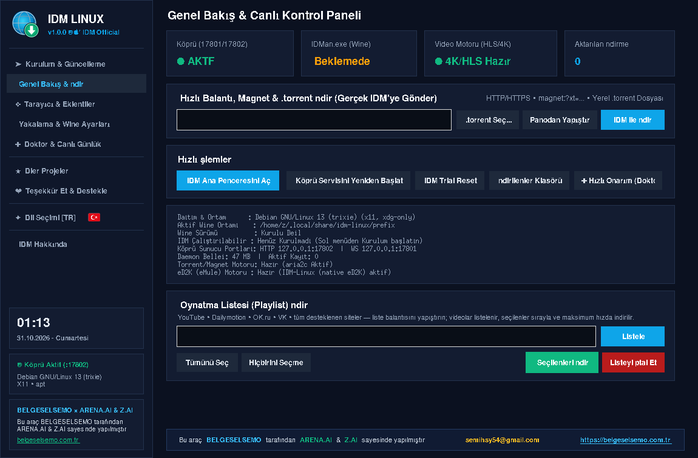
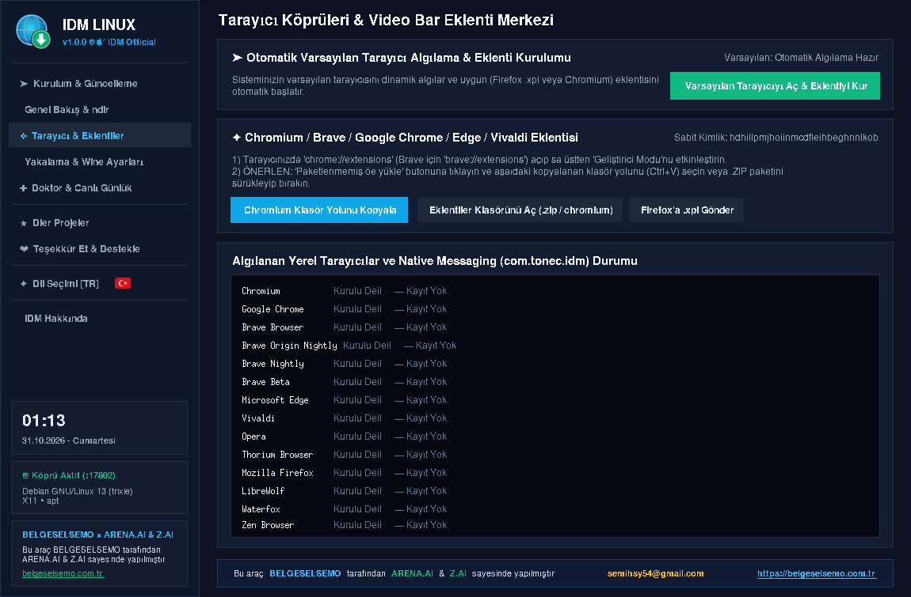
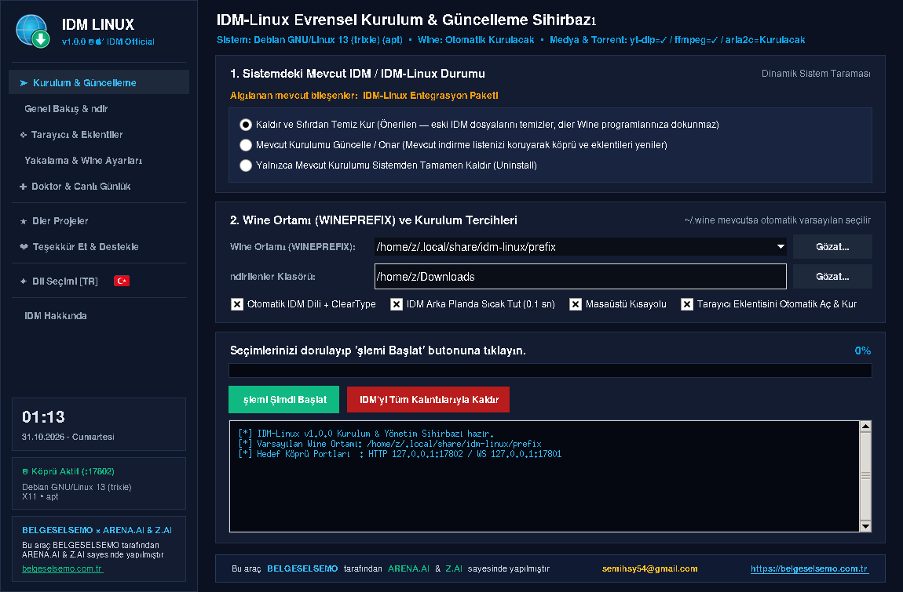

# 🚀 IDM LINUX (BELGESELSEMO)

  &nbsp;&nbsp;

  <strong>IDM LINUX</strong>, Tonec Inc.'in efsanevi indirme yöneticisi <strong>Internet Download Manager</strong>'ın tüm gücünü Linux'a taşıyan bağımsız bir entegrasyon katmanıdır. Tarayıcı yakalama, video siteleri, torrent ve canlı yayın DVR katmanları tek bir hafif kontrol panelinde birleşir; indirmeler gerçek IDM motoru üzerinden maksimum hızda yürür.

  <a href="https://rawgit.loltek.net/https://raw.githubusercontent.com/vesvese55x/IDM-LINUX/refs/heads/main/promo/promo.html" target="_blank" rel="noreferrer"><strong>TANITIM SUNUMU</strong></a>
  ·
  <a href="https://htmlpreview.github.io/?https://github.com/vesvese55x/IDM-LINUX/blob/main/promo/promo.html" target="_blank" rel="noreferrer"><strong>TANITIM YEDEK LİNK</strong></a>
  ·
  <a href="https://belgeselsemo.com.tr" target="_blank" rel="noreferrer"><strong>BELGESELSEMO.COM.TR</strong></a>
  ·
  <a href="https://github.com/vesvese55x/IDM-LINUX" target="_blank" rel="noreferrer"><strong>GITHUB</strong></a>

## IDM deneyimi Linux'ta

IDM LINUX; Wine üzerinde koşan gerçek IDM motorunu, Linux tarafında hafif bir Python kontrol paneliyle buluşturur. Kurulum sihirbazı Wine ortamını ve resmî IDM kurulumunu otomatik hazırlar; Genel Bakış ekranı köprü durumunu, video motorunu ve hızlı indirme araçlarını tek ekranda gösterir. Hızlı bağlantı kutusuna URL, magnet veya yerel .torrent dosyası bırakmanız yeterli — gerisini IDM LINUX halleder.

  

## İndirme katmanları

✨ <strong>Tarayıcı entegrasyonu</strong> — Chromium ve Firefox tabanlı tüm tarayıcılarda eklenti; indirme taleplerini otomatik yakalar ve IDM'ye devreder.  
🎬 <strong>Video motoru (HLS/4K)</strong> — yt-dlp / streamlink zinciriyle video siteleri; en uygun motor otomatik seçilir, akış doğrudan IDM'ye aktarılır.  
🧲 <strong>Gömülü torrent motoru</strong> — magnet ve .torrent desteği, DHT ile tracker'sız peer keşfi; onay penceresinden içerik ya da yalnızca .torrent dosyası indirme.  
📦 <strong>Dosya barındırıcılar</strong> — popüler barındırıcı siteler için konuk oturumu ve doğrudan bağlantı çözümleme; dosya bozuk inmez.  
📺 <strong>Canlı yayın / DVR kaydı</strong> — canlı akışlardan kayıt alabilen DVR katmanı, arayüzden yönetilir.  
📜 <strong>Oynatma listesi</strong> — YouTube/Dailymotion vb. liste bağlantısını yapıştırın; videolar listelenir, seçilenler sırayla indirilir.

  
  

## Sistem Doktoru ve canlı günlükler

Sorun anında kaynağı tahmin etmeye gerek yok: 6 adımlı otomatik teşhis ve tamir doktoru köprüyü, video motorunu ve tarayıcı bağlantılarını tek tıkla onarır. daemon.log ve native_host.log canlı günlükleri aynı ekranda akar; uzak log gönderimiyle destek ekibine tek tıkla paylaşılır. "İptal = tam dur" ilkesi sayesinde herhangi bir indirmeyi iptal ettiğinizde arka planda hiçbir motor devam etmez.

  

## BELGESELSEMO ekosistemi, dil desteği ve destek

IDM LINUX, BELGESELSEMO evreninin masaüstü parçasıdır: web portalları, YouTube kanalı, Google Play uygulamaları ve yardımcı araçlar aynı ekosistemi paylaşır. Arayüz 20 dilde çalışır (varsayılan Türkçe); destek sayfasından YouTube aboneliği, Google Play puanı veya bağış yollarıyla projelere katkı verilebilir.

  
  

## Kişiselleştirme ve ayarlar

Köprü portları, indirme klasörü, Wine önek konumu, arayüz dili ve tarayıcı yakalama davranışı tek ekrandan yönetilir. `--no-sandbox` gerektiren ortamlar dinamik olarak algılanır; kurulum sırasında ve tarayıcı açılışlarında gerekli parametre otomatik eklenir; `--no-sandbox` engeli kökten kaldırılır.

  

## Platform paketleri ve kurulum komutları

<table>
  <tr>
    <td><strong>Paket</strong></td>
    <td><strong>Ne için?</strong></td>
    <td><strong>Kurulum / Çalıştırma komutu</strong></td>
  </tr>
  <tr>
    <td>📦 <strong>AppImage</strong></td>
    <td>Kurulum gerektirmez; indir, çalıştırılabilir yap, çift tıkla</td>
    <td><code>chmod +x IDM-LINUX-1.0.0-x86_64.AppImage &amp;&amp; ./IDM-LINUX-1.0.0-x86_64.AppImage</code></td>
  </tr>
  <tr>
    <td>🐧 <strong>deb</strong></td>
    <td>Debian / Ubuntu / Mint ve türevleri; gdebi gibi GUI yükleyicilerle de uyumlu</td>
    <td><code>sudo apt install ./idm-linux_1.0.0_all.deb</code></td>
  </tr>
  <tr>
    <td>🎩 <strong>rpm</strong></td>
    <td>Fedora / openSUSE / RHEL türevleri</td>
    <td><code>sudo dnf install ./idm-linux-1.0.0-1.noarch.rpm</code></td>
  </tr>
  <tr>
    <td>🏔️ <strong>zst</strong></td>
    <td>Arch / Manjaro ve türevleri</td>
    <td><code>sudo pacman -U idm-linux-1.0.0-1-any.pkg.tar.zst</code></td>
  </tr>
</table>

🌟 Tüm paketler aynı <strong>IDM-LINUX-1.0.0</strong> sürümünü taşır ve [GitHub Releases](https://github.com/vesvese55x/IDM-LINUX/releases/tag/v1.0.0) sayfasından indirilir.  
🧰 Kurulum sihirbazı; Wine, resmî IDM, tarayıcı eklentileri ve yt-dlp/ffmpeg/aria2 araçlarını gerektiğinde otomatik indirip kurar.  
🧩 Gereksinimler: Linux (x86_64 önerilir) ve Python 3.8+; masaüstü ortamı (X11/Wayland) GUI için önerilir.  
🌐 Arayüz 20 dilde çalışır; Türkçe varsayılan olarak gelir.

## Mobil BELGESELSEMO ekosistemi

BELGESELSEMO dünyası masaüstüyle sınırlı değildir. Android tarafında da belgesel, trivia, TV rehberi, nöbetçi eczane, Nutuk ve ekonomi odaklı uygulama katmanları aynı ekosistemi sürdürür.

<table>
  <tr>
    <td align="center" width="33%">
      <a href="https://play.google.com/store/apps/details?id=com.belgeselsemo.tr" target="_blank" rel="noreferrer">
         
        <strong>BELGESELSEMO</strong>
      </a>
    </td>
    <td align="center" width="33%">
      <a href="https://play.google.com/store/apps/details?id=com.belgeselsemo.trivia" target="_blank" rel="noreferrer">
         
        <strong>BELGESELSEMO TRIVIA</strong>
      </a>
    </td>
    <td align="center" width="33%">
      <a href="https://play.google.com/store/apps/details?id=com.belgeselsemo.epgviewer" target="_blank" rel="noreferrer">
         
        <strong>BELGESELSEMO TV REHBERİ (EPG)</strong>
      </a>
    </td>
  </tr>
  <tr>
    <td align="center" width="33%">
      <a href="https://play.google.com/store/apps/details?id=com.belgeselsemo.nb724" target="_blank" rel="noreferrer">
         
        <strong>NÖBETÇİ ECZANELER 7/24 TR-KKTC</strong>
      </a>
    </td>
    <td align="center" width="33%">
      <a href="https://play.google.com/store/apps/details?id=com.belgeselsemo.nutuk" target="_blank" rel="noreferrer">
         
        <strong>NUTUK 1919-1927</strong>
      </a>
    </td>
    <td align="center" width="33%">
      <strong>BELGESELSEMO ECONOMY</strong> 
      Yakında
    </td>
  </tr>
</table>

## Tanıtım sunumu

Repo içinde uygulamayı daha zengin ve sunum odaklı şekilde anlatan ayrı bir tanıtım sayfası bulunur:

🌐 Canlı tanıtım: <a href="https://rawgit.loltek.net/https://raw.githubusercontent.com/vesvese55x/IDM-LINUX/refs/heads/main/promo/promo.html" target="_blank" rel="noreferrer">rawgit.loltek.net</a>  
🛟 Yedek tanıtım: <a href="https://htmlpreview.github.io/?https://github.com/vesvese55x/IDM-LINUX/blob/main/promo/promo.html" target="_blank" rel="noreferrer">htmlpreview.github.io</a>  
🪂 Ek yedek: <a href="https://gh.maple3142.workers.dev/vesvese55x/IDM-LINUX/main/promo/promo.html" target="_blank" rel="noreferrer">gh.maple3142.workers.dev</a>  
📁 Repo içi dosya: <a href="promo/promo.html" target="_blank" rel="noreferrer">promo/promo.html</a>

Bu sayfa; ekranlar, indirme katmanları, sistem araçları, platform paketleri ve mobil ekosistemle birlikte <strong>tüm özellikleri ve işlevselliğiyle IDM LINUX deneyimini tek sahnede anlatır</strong>.
